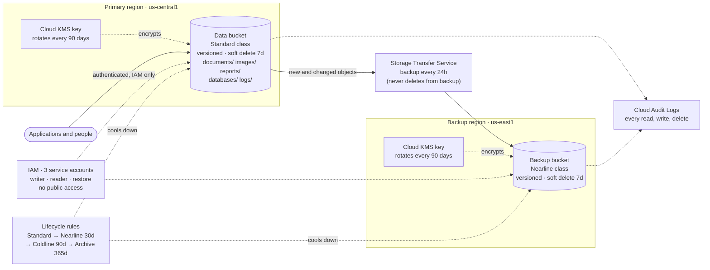

# Project 2 – Cloud Storage & Backup Management (Google Cloud + Terraform)

A complete, reusable **Infrastructure as Code** project that securely stores, manages and protects organizational data on **Google Cloud Storage**. It combines an organized bucket hierarchy, encryption and least-privilege access, versioning and soft delete, **automated cross-region backups**, cost-aware storage classes, and documented recovery procedures.

One command (`terraform apply`) builds the whole platform. One command (`terraform destroy`) removes it.

---

## Table of contents

1. [What it deploys](#1-what-it-deploys)
2. [Architecture](#2-architecture)
3. [How it meets the project requirements](#3-how-it-meets-the-project-requirements)
4. [Project structure](#4-project-structure)
5. [Prerequisites](#5-prerequisites)
6. [Deployment guide](#6-deployment-guide)
7. [Configuration reference](#7-configuration-reference)
8. [Try it: live demo script](#8-try-it-live-demo-script)
9. [Backup schedule and recovery](#9-backup-schedule-and-recovery)
10. [Storage classes and cost](#10-storage-classes-and-cost)
11. [Security design](#11-security-design)
12. [Testing](#12-testing)
13. [Cleanup](#13-cleanup)
14. [Troubleshooting](#14-troubleshooting)
15. [Possible improvements](#15-possible-improvements)

---

## 1. What it deploys

36 resources in the default configuration, grouped into five Terraform modules:

| Module | Resources | Purpose |
|---|---|---|
| **bucket** (used twice) | Hardened Cloud Storage bucket with versioning, soft delete, encryption, lifecycle rules | One reusable definition for the live data bucket and the backup bucket |
| **encryption** | 2 Cloud KMS key rings, 2 auto-rotating keys, IAM for Cloud Storage | Customer-managed encryption, one key per region |
| **iam** | 3 service accounts (writer, reader, restore) + bucket-level role bindings | Least-privilege access, no public principals |
| **backup** | Storage Transfer Service job, IAM for the transfer service | Scheduled automatic copy to the second region |
| *(root)* | Google API enablement, audit-log config, 6 sample files | Platform wiring, audit trail and a ready-made folder hierarchy |

## 2. Architecture



**Data flow:** applications write to the data bucket as the `writer` service account. Every change creates a new object version. Once a day the transfer job copies new and changed objects to the backup bucket in a different region. If data is deleted or damaged, you restore from an old version, from soft delete, or from the backup bucket (see the [runbook](docs/RECOVERY_RUNBOOK.md)).

## 3. How it meets the project requirements

| Requirement | How this project delivers it |
|---|---|
| **Well-organized** – buckets, containers and file structures follow a logical hierarchy | Two buckets with a naming standard (`<prefix>-<env>-<purpose>-<project>`: `...-data-...`, `...-backup-...`). Inside the data bucket, folders by data type: `documents/`, `images/`, `reports/`, `databases/`, `logs/`. Consistent labels (`project`, `environment`, `purpose`, `data-class`) on every resource. Rules written down in [`docs/STORAGE_POLICY.md`](docs/STORAGE_POLICY.md). |
| **Secure** – encryption, permissions, authentication | **Encryption:** customer-managed Cloud KMS keys, auto-rotated every 90 days (TLS in transit). **Permissions:** uniform bucket-level access, public access prevention enforced, 3 purpose-built service accounts, validation that rejects `allUsers`. **Authentication:** every request must be authenticated through IAM (Google identities or service accounts). **Audit:** data-access logs for who read, wrote or deleted what. |
| **Reliable** – automated backups and versioning ensure recovery | Versioning (up to 5 old versions per object), soft delete (7 days), a **scheduled backup job** that copies to a **second region** every 24 hours, and a versioned backup bucket. Three tested recovery paths in the [runbook](docs/RECOVERY_RUNBOOK.md). |
| **Cost-effective** – storage classes by access frequency and business needs | Lifecycle rules cool data automatically: **Standard → Nearline (30 d) → Coldline (90 d) → Archive (365 d)**. Backups start in Nearline. Old versions are capped by age and count so versioning stays cheap. Thresholds are variables. |
| **Clearly documented** – backup schedules, recovery procedures, storage policies | This README, [`docs/RECOVERY_RUNBOOK.md`](docs/RECOVERY_RUNBOOK.md) (backup schedule, RPO/RTO, step-by-step recovery, quarterly test), [`docs/STORAGE_POLICY.md`](docs/STORAGE_POLICY.md) (naming, security, classes), a live [demo script](#8-try-it-live-demo-script), and descriptions on every variable and output. |

## 4. Project structure

```
project-2-cloud-storage-backup-management/
├── README.md                      # this file
├── versions.tf                    # Terraform + provider version constraints
├── main.tf                        # APIs, keys, buckets, IAM, audit logs, backup job
├── variables.tf                   # all inputs (with validation)
├── outputs.tf                     # bucket names, job name, service accounts, summary
├── terraform.tfvars.example       # copy to terraform.tfvars and edit
├── .terraform.lock.hcl            # pinned provider versions (commit this)
├── .gitignore                     # keeps state, tfvars and credentials out of git
├── modules/
│   ├── bucket/                    # reusable hardened bucket (versioning, lifecycle, CMEK)
│   ├── encryption/                # Cloud KMS key rings and keys
│   ├── iam/                       # service accounts and bucket permissions
│   └── backup/                    # Storage Transfer Service backup job
├── sample-data/                   # becomes documents/ images/ reports/ databases/ logs/
├── docs/
│   ├── RECOVERY_RUNBOOK.md        # backup schedule and recovery procedures
│   └── STORAGE_POLICY.md          # naming, security, reliability and cost rules
├── scripts/
│   └── demo.ps1                   # live demo: hierarchy, versioning, restore, backup
└── tests/
    └── storage.tftest.hcl         # offline tests (providers mocked, no GCP account needed)
```

## 5. Prerequisites

| Need | Notes |
|---|---|
| **Terraform ≥ 1.9** | [Install guide](https://developer.hashicorp.com/terraform/install) (Windows: `winget install Hashicorp.Terraform`). |
| **A GCP project with billing enabled** | Create one in the [console](https://console.cloud.google.com/projectcreate) and link a billing account. |
| **Google Cloud CLI (`gcloud`)** | [Install guide](https://cloud.google.com/sdk/docs/install). Used for login and the demo script. |
| **Permissions** | `Owner` on the project (or Editor + Project IAM Admin + Service Usage Admin + Cloud KMS Admin). |

## 6. Deployment guide

**1. Log in** (opens a browser each time)

```bash
gcloud auth login
gcloud auth application-default login
```

**2. Select your project**

```bash
gcloud config set project YOUR_PROJECT_ID
gcloud auth application-default set-quota-project YOUR_PROJECT_ID
```

**3. Initialize**

```bash
cd project-2-cloud-storage-backup-management
terraform init
```

**4. Preview**

```bash
terraform plan -var="project_id=YOUR_PROJECT_ID"
```

You should see **36 resources to add**.

**5. Deploy**

```bash
terraform apply -var="project_id=YOUR_PROJECT_ID"
```

Type `yes`. It takes about 3–5 minutes; two short waits (about 45 seconds each) are deliberate, so IAM permissions have time to propagate before the buckets and the backup job are created.

**6. See the result**

```bash
terraform output
```

Instead of `-var`, you can copy `terraform.tfvars.example` to `terraform.tfvars` and set `project_id` once.

## 7. Configuration reference

All variables live in `variables.tf`. Only `project_id` is required.

| Variable | Default | Description |
|---|---|---|
| `project_id` | *(required)* | GCP project ID |
| `region` | `us-central1` | Region of the data bucket |
| `backup_region` | `us-east1` | Region of the backup bucket (must differ from `region`) |
| `environment` | `dev` | `dev`, `staging` or `prod` |
| `name_prefix` | `cloudstore` | Name prefix (3–12 chars, lowercase) |
| `enable_cmek` | `true` | Customer-managed encryption keys (Cloud KMS) |
| `kms_rotation_days` | `90` | Automatic key rotation period |
| `enable_audit_logs` | `true` | Data-access audit logs for Cloud Storage |
| `reader_members` / `writer_members` / `admin_members` | `[]` | People or groups to grant access, e.g. `["user:me@example.com"]`. Public principals are rejected. |
| `soft_delete_days` | `7` | Deleted-object recovery window (0 = off, otherwise 7–90) |
| `noncurrent_retention_days` | `30` | Days old versions are kept |
| `max_noncurrent_versions` | `5` | Old versions kept per object (data bucket) |
| `backup_interval_hours` | `24` | Hours between backups (your RPO) |
| `backup_start_hour_utc` | `2` | Hour of day the backup schedule starts |
| `nearline_after_days` | `30` | Standard → Nearline |
| `coldline_after_days` | `90` | Nearline → Coldline |
| `archive_after_days` | `365` | Coldline → Archive |
| `upload_sample_data` | `true` | Upload `sample-data/` to create the folder hierarchy |
| `force_destroy` | `true` | Let `destroy` delete non-empty buckets |
| `extra_labels` | `{}` | Extra labels for all resources |

**Outputs:** `data_bucket_name`, `backup_bucket_name`, `data_bucket_url`, `backup_bucket_url`, `backup_job_name`, `backup_interval_hours`, `object_hierarchy`, `service_accounts`, `kms_keys`, `design_summary`.

## 8. Try it: live demo script

After `terraform apply`, run the included script from the project folder. It takes about 2 minutes and shows every requirement working:

```powershell
powershell -ExecutionPolicy Bypass -File scripts\demo.ps1
```

| Step | What you see |
|---|---|
| 1. Well-organized | Both buckets with their locations, and the folder tree of the data bucket |
| 2. Secure | The bucket's encryption key, enforced public-access prevention, uniform access, versioning and soft delete |
| 3. Reliable | A file is uploaded twice; both versions are listed |
| 4. Disaster recovery | The file is deleted, shown to be gone, then restored from its stored version |
| 5. Backup | The backup job runs and the files appear in the second region |

Console pages worth showing: **Cloud Storage → Buckets** (two regions), a bucket's **Configuration** tab (encryption, versioning, soft delete) and **Lifecycle** tab, **Security → Key Management** (the keys), **Data Transfer → Transfer jobs** (the backup job and its run history), and **IAM**.

## 9. Backup schedule and recovery

| Protection | Setting | Recovery point |
|---|---|---|
| Object versioning | Every change, up to 5 old versions for 30 days | Seconds |
| Soft delete | Deleted data recoverable for 7 days | Seconds |
| Automated backup | Every 24 h at 02:00 UTC to a second region; never deletes from the backup | Up to 24 h |

Recovery steps for a single object, a deleted object, a whole folder or a whole bucket, plus a quarterly recovery test, are in [`docs/RECOVERY_RUNBOOK.md`](docs/RECOVERY_RUNBOOK.md). Quick example (restore one version):

```bash
gcloud storage ls -a gs://BUCKET/documents/company-policy.txt
gcloud storage cp "gs://BUCKET/documents/company-policy.txt#GENERATION" gs://BUCKET/documents/company-policy.txt
```

## 10. Storage classes and cost

| Class | Used for | Reached after | Cost profile |
|---|---|---|---|
| Standard | Active data | New objects | Highest storage price, no retrieval fee |
| Nearline | About monthly access | 30 days (backups start here) | Lower storage price, small retrieval fee |
| Coldline | About quarterly access | 90 days | Lower still |
| Archive | About yearly access | 365 days | Lowest storage price, highest retrieval fee |

Cooler classes have minimum storage durations (30 / 90 / 365 days), so the default transition ages respect them. The sample data is a few kilobytes, so a short demo costs **a few cents at most**. Costs that grow with real use: storage volume, KMS key versions (a small fixed monthly fee per key), the backup bucket (a second copy of your data), and audit-log volume.

## 11. Security design

| Control | Implementation |
|---|---|
| **No public access** | Public access prevention enforced on both buckets; Terraform rejects `allUsers` and `allAuthenticatedUsers`. |
| **IAM only** | Uniform bucket-level access (no ACLs). Every request must be authenticated. |
| **Least privilege** | `writer` (read/write data), `reader` (read data), `restore` (read backups, write data). The transfer service has its own scoped permissions. Only admins can write to the backup bucket. |
| **Encryption at rest** | Customer-managed keys in Cloud KMS, one per region, automatic 90-day rotation. Google-managed encryption stays on as the fallback when `enable_cmek = false`. |
| **Encryption in transit** | TLS for all Cloud Storage access. |
| **Audit trail** | Cloud Audit Logs record admin activity and every data read, write and delete. |
| **Recoverability as security** | Versioning, soft delete and the cross-region backup protect against accidental deletion, malicious deletion and ransomware-style overwrites. |
| **Secrets** | `.gitignore` excludes `*.tfvars`, state files and key files. No credentials are in the code. |

## 12. Testing

The project ships with an automated test suite that runs **without a GCP account** by mocking the providers.

```bash
terraform init -backend=false
terraform fmt -check -recursive      # formatting
terraform validate                   # syntax and references
terraform test                       # 13 offline tests
```

| Test | Asserts |
|---|---|
| `buckets_follow_a_logical_hierarchy` | Five top-level folders; bucket names follow the standard; data bucket is Standard class |
| `sample_data_can_be_skipped` | No folders when `upload_sample_data = false` |
| `buckets_are_private_and_encrypted` | Public access enforced, uniform access, customer-managed keys and audit logging on both buckets |
| `cmek_can_be_disabled` | `enable_cmek = false` creates no keys and no key references |
| `backups_are_versioned_and_in_another_region` | Versioning on, 7-day soft delete, backup in a different region, daily backups |
| `lifecycle_cools_data_down_by_access_frequency` | Standard → Nearline → Coldline → Archive; backups start in Nearline |
| 7 × `rejects_*` | Same-region backup, public principals, wrong lifecycle order, invalid soft delete, bad interval and bad environment are refused |

**Verified results:** `terraform fmt -check` clean, `terraform validate` successful, `terraform test` → **13 passed, 0 failed** (Terraform 1.17.1; `hashicorp/google` 6.50.0, `random` 3.9.1, `time` 0.14.2). The first test run also caught a real bug in my code (indexing a set), which I fixed. I confirmed the tests are meaningful by temporarily switching public-access prevention to `inherited`; the security test failed as expected, then I reverted it.

> These are plan-time tests against mocked providers. They prove the configuration is valid and enforces the design. A real `terraform apply` needs your own GCP project (section 6); the live demo script then proves the behaviour on real Cloud Storage.

## 13. Cleanup

```bash
terraform destroy -var="project_id=YOUR_PROJECT_ID"
```

Type `yes`. Buckets are removed even when they contain objects (`force_destroy = true`). Two things stay behind by design: the enabled Google APIs, and the **Cloud KMS key rings**, which Google does not allow to be deleted (they cost nothing without key versions in use; the keys' versions are scheduled for destruction). Terraform uses a random suffix on key ring names, so you can re-deploy any time without name collisions. To remove absolutely everything, delete the whole project: `gcloud projects delete YOUR_PROJECT_ID`.

## 14. Troubleshooting

| Symptom | Cause / fix |
|---|---|
| `API has not been used in project ... or it is disabled` | The API was just enabled and needs a minute to propagate. Wait and re-run `terraform apply`. |
| `Permission denied on Cloud KMS key` or `Cannot create bucket with key` | IAM propagation lag. Re-run `terraform apply`. |
| Backup job creation fails with a permission or bucket error | Same IAM lag. Re-run `terraform apply`. |
| `Error 409 ... already exists` after an interrupted run | A resource was created but not recorded. Delete it (console or `gcloud`), or `terraform import` it, then re-run. |
| `The project ... does not have billing enabled` | Link a billing account to the project. |
| `bucket name already exists` | Bucket names are global. Change `name_prefix` or `environment`. |
| `Error: Invalid value for variable` | A validation rule triggered; read the message (e.g. `backup_region` must differ from `region`). |
| Demo script: `gcloud` not found | Add the Cloud SDK `bin` folder to `PATH` or reopen the terminal. |
| Demo script: transfer job does not start | The script falls back to `gcloud storage rsync` automatically. |

## 15. Possible improvements

- **Bucket Lock / retention policy** on the backup bucket for regulatory immutability (irreversible once locked, so it is left out of the demo).
- **Alerting** on failed backup runs (Cloud Monitoring alert on Storage Transfer metrics).
- **Pub/Sub or Eventarc** notifications for object changes.
- **Dual-region or multi-region buckets** for the data bucket itself.
- **Remote Terraform state** in a Cloud Storage bucket for team use.
- **VPC Service Controls** to restrict where the data can be accessed from.
